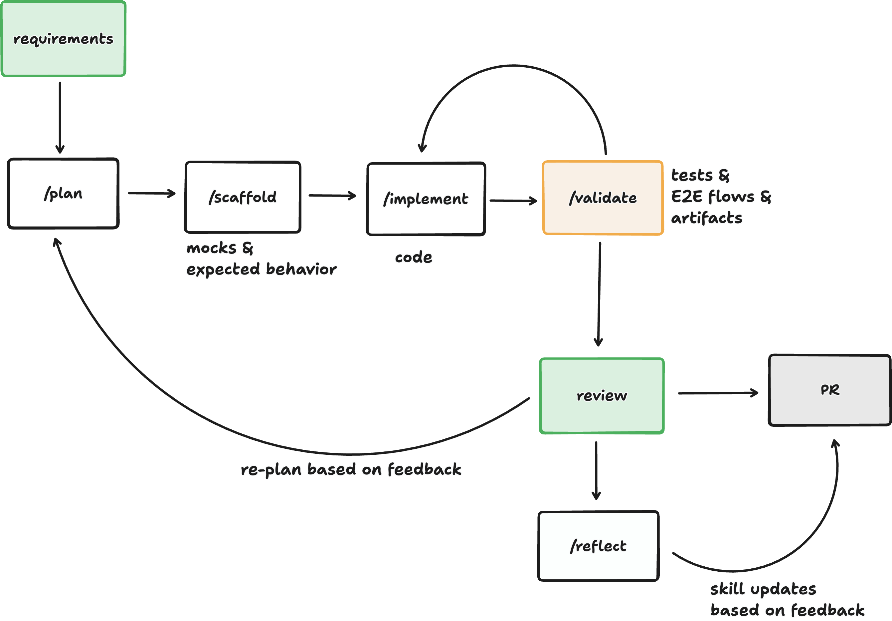

# Slice Loop

A Cursor plugin that drops a test-driven, autonomous build loop into any codebase. A cloud agent runs it end to end and hands back a **compressed review packet**: a verdict, an acceptance-criteria table, screenshots, a short recording, and log excerpts, scannable in under two minutes.



| Node | Component | What it does |
| --- | --- | --- |
| requirements | input | Text, a file, or a ticket, plus attachments |
| `/plan-tasks` | skill | One-page slice plan; every acceptance criterion names the test or flow that will prove it |
| `/scaffold` | skill | Failing tests, mocks, fixtures, E2E flow specs, and compile-only stubs, each proven red for the right reason |
| `/implement` | skill | The smallest change that turns them green, without weakening the tests |
| `/validate` | skill | Re-runs every gate independently, boots and drives the app, audits the test contract, **looks at** the captures, and writes the review packet |
| review | human gate | Approve, or reply with feedback (which triggers a re-plan) |
| `/reflect` | skill | Turns feedback and loop friction into edits to the project's loop files, shipped in the same PR |
| — | `/create-loop` skill | Onboards the loop into a codebase: discovery, Q&A for gaps, then generates the project-specific loop |
| — | `implement-slice` subagent | Runs the whole loop for one slice and stops at review |

## How it adapts to a codebase

The five loop skills are **templates**: generic, and never edited per project. `/create-loop` writes everything project-specific into the target repo instead:

```
.cursor/loop/
├── LOOP.md          # manifest: commands (verified/inferred), surfaces, boot, gates, dirs, limits,
│                    #   mock policy, assumptions, harness smoke results, changelog
├── context/         # facts the skills need ahead of time: architecture, testing, validation,
│   └── sources/     #   domain, review preferences, digests of attached specs/tickets/designs
├── overlays/        # per-skill behavior changes: <skill>.md with Skip / Replace / Add by step heading
├── scripts/         # project harness: boot.sh, teardown.sh, seed.sh
├── flows/           # E2E flow modules (only when the project has no E2E suite)
└── runs/<slice-id>/ # plan, scaffold contract, iteration log, validate packet, state.json (gitignored by default)
```

Every skill loads its inputs in the same order: `LOOP.md`, then its overlay, then the context files whose trigger applies. **Overlay beats context and manifest, which beat the template.** Facts go in `context/`; behavior changes go in `overlays/`. `/reflect` edits these same files after each review, so the loop improves per project without forking the plugin.

`/create-loop` asks the user only what discovery couldn't answer, using Cursor's `AskQuestion` tool. Questions are pre-filled with what it found ("CI runs `pnpm test`, README says `npm test`; which is canonical?"). In cloud agents with no human present it runs autonomously instead: it picks conservative defaults and records each one under `## Assumptions` in `LOOP.md` for review. See `skills/create-loop/references/question-bank.md`.

## The review packet

`/validate` writes `<run>/validate/` and copies it to `/opt/cursor/artifacts/<slice-id>/` when running in a cloud agent:

```
report.md        # verdict line, 3-bullet TL;DR, lead screenshot, AC table, gates, flows, failures (≤10-line excerpts), diff stat, repro
verdict.json     # machine-readable: gates, per-AC result, classified failures, next route
artifacts/       # one screenshot per AC, mp4 per flow (≤60s), GIF preview, contact sheet
raw/             # compressed log excerpts, flow steps.json
```

Failures are classified (`impl-bug`, `contract`, `spec-gap`, `regression`, `env`, `harness-unproven`), and the class decides where the loop goes next. Bundled scripts in `skills/validate/scripts/`:

- `compress_log.py` keeps the head, the tail, the summary lines, and windows around the earliest failures; strips ANSI codes; collapses repeated lines; and marks every omission.
- `compress_media.sh` produces downscaled screenshots, trimmed H.264 MP4s, palette GIFs, and contact sheets. It degrades to a plain copy when ffmpeg is missing.
- `run_flow.mjs` runs a plain Playwright flow module and records video, named capture points, per-step status, console errors, and failed requests. It resolves Playwright from the project or the scratch dir, and falls back to system Chrome.

## Install

**Local:**

```bash
git clone --depth 1 https://github.com/cursor/cookbook.git /tmp/cookbook
mkdir -p ~/.cursor/plugins/local
cp -R /tmp/cookbook/plugins/slice-loop ~/.cursor/plugins/local/slice-loop
```

**Team marketplace:** `.cursor-plugin/marketplace.json` is included; copy this directory into its own repo and add that repo as a team plugin source.

**Cloud agents:** enable the plugin for your team, or add its repo alongside the target repo, so the skills and subagent resolve in the agent's session.

## Use

1. In the target repo, run `/create-loop`. Answer the questions it can't resolve from the code, and attach any specs or docs. Review and commit `.cursor/loop/`.
2. Ask for a slice: "Use the `implement-slice` subagent to add CSV export to the reports page." It plans, scaffolds, iterates implement ⇄ validate, and returns a short summary pointing at the packet.
3. Review the packet. Reply with feedback to re-plan, or approve, which runs `/reflect`, commits, pushes, and opens a draft PR if `LOOP.md` says so.

Each skill also works on its own, for example `/validate` after a hand-written change.

## Develop

```bash
python3 -m unittest discover -s tests -v
```

The tests check the manifest, skill frontmatter, cross-references between skills and their bundled files, and the agent's coverage of every loop skill. They also exercise `compress_log.py`, `compress_media.sh` (skipped without ffmpeg), and `run_flow.mjs` against a fixture app (skipped without Playwright).

`examples/tasks-app/` is a tiny dependency-free app used to dry-run the loop end to end. `examples/sample-run/` is the output of one autonomous run against it: the generated `.cursor/loop/` plus a complete review packet. Start with its README to see what the loop produces.

## License

MIT
