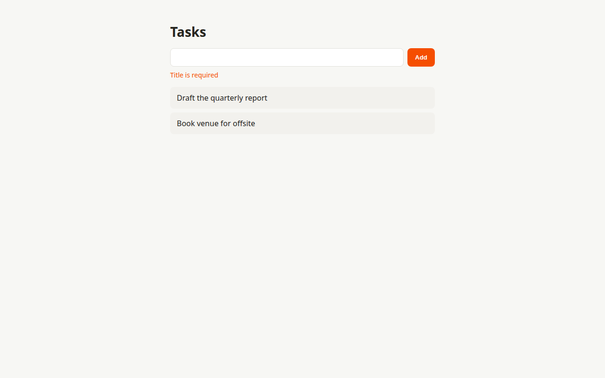
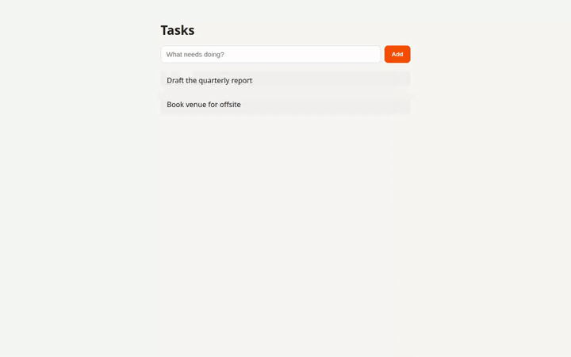
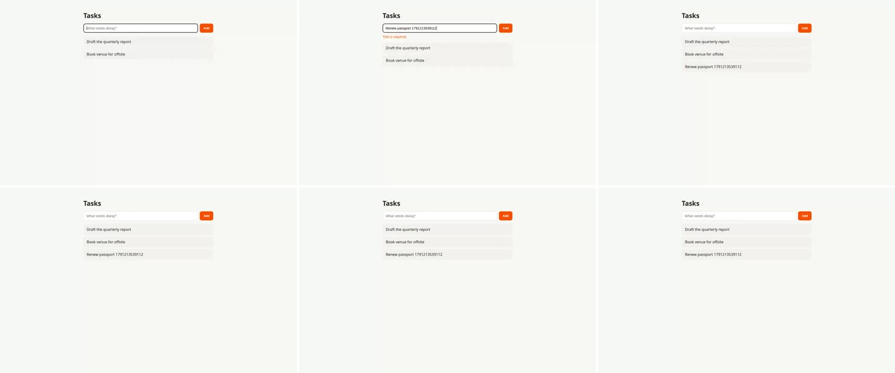

# PASS — Reject blank task titles

`20261005-reject-blank-titles` · iteration 1 · `c4a8758` · [plan](../plan.md) · [verdict.json](./verdict.json)

- **Changed:** The API now answers 400 `{ "error": "Title is required" }` for empty, whitespace-only, or missing titles without creating a task, and the page shows that message under the input until the next successful add.
- **Proof:** 5/5 acceptance criteria pass; tests 6 passed, 0 failed, 0 skipped; E2E flows 2/2 (`blank-title`, `create-task`); lint passes; no test changed after the scaffold commit.
- **Watch:** Each rejected submit makes Chrome log "Failed to load resource: 400" in the console. That is the browser reporting the intended 400, not a script error, but a console-error monitor would flag it. A client-side pre-check would avoid the request if that matters.



## Acceptance criteria

| ID | Result | Evidence |
| --- | --- | --- |
| AC-1 | PASS | "AC-1: rejects an empty title with 400 and creates no task" · [transcript](raw/api-AC-1.txt): `HTTP/1.1 400 Bad Request`, body `{"error":"Title is required"}`, task list identical before and after. |
| AC-2 | PASS | "AC-2: rejects a whitespace-only title…" (spaces; and space, tab, newline) · [transcript](raw/api-AC-2.txt): `400`, same body, list unchanged. |
| AC-3 | PASS | "AC-3: rejects a missing title…" · [transcript](raw/api-AC-3.txt): `{}` gets `400`, same body, list unchanged. |
| AC-4 | PASS | `blank-title` steps "submit empty title" and "submit whitespace-only title" both assert the message sits below the input and the item count stays put · [screenshot](artifacts/AC-4-error.png) — message in the accent color right under the input; the two seeded tasks are the only items. |
| AC-5 | PASS | `blank-title` steps "submit a valid title" and "message cleared" · [screenshot](artifacts/AC-5-cleared.png) — "Renew passport …" appended as the third task, the message is gone, and the input is empty again. |

## Gates

| Gate | Result | Excerpt |
| --- | --- | --- |
| lint | pass | [raw](raw/lint.txt) |
| test | 6 passed, 0 failed, 0 skipped | [raw](raw/test.txt) |
| e2e | 2/2 flows | [steps](raw/flows.json) |
| contract | intact | [audit](raw/contract.txt): no test or flow file changed after `4fb02f8` |

`typecheck` and `build` are not gates in this project (plain JavaScript, no build step). The test gate is `node --test test/*.test.js` because `npm test` is broken on Node 22 on the base commit too (see Risks).

## Flows

### blank-title — pass (6/6 steps)

[Recording (1.3 s)](artifacts/blank-title.mp4) · 



Console: two "Failed to load resource: 400" lines, one per rejected submit; no page errors. Failed requests: the same two intentional `POST /api/tasks` 400s.

### create-task (regression) — pass (4/4 steps)

[Recording (1.1 s)](artifacts/create-task.mp4) · [screenshot](artifacts/create-task-added.png) — a valid title still appends and clears the input. No console errors or failed requests.

## Changes

```text
 public/app.js     | 8 +++++++-
 public/index.html | 5 ++++-
 server.js         | 1 +
 3 files changed, 12 insertions(+), 2 deletions(-)
```

Scaffold commit `4fb02f8` added `test/api.test.js` and `.cursor/loop/flows/blank-title.mjs`. Test changes logged by implement: none.

## Risks and follow-ups

- `npm test` (`node --test test/`) fails on Node 22 with "Cannot find module …/test", before and after this slice. Follow-up slice: change the script to `node --test test/*.test.js`.
- A malformed JSON body still returns 500 rather than 400; out of scope here, listed as a later slice in the plan.
- The UI keeps the whitespace the user typed after a rejected submit (visible as an empty-looking input in the AC-4 screenshot); that matches the requirement, which only asks that the message clears after a successful add.

## Reproduce

```bash
npm run lint
node --test test/*.test.js
.cursor/loop/scripts/boot.sh
node <validate-skill>/scripts/run_flow.mjs .cursor/loop/flows/blank-title.mjs \
  --base-url http://127.0.0.1:4319 --out /tmp/slice-loop/20261005-reject-blank-titles/flows/blank-title --scratch /tmp/slice-loop
curl -si -X POST http://127.0.0.1:4319/api/tasks -H 'content-type: application/json' -d '{"title":"  "}'
.cursor/loop/scripts/teardown.sh
```
