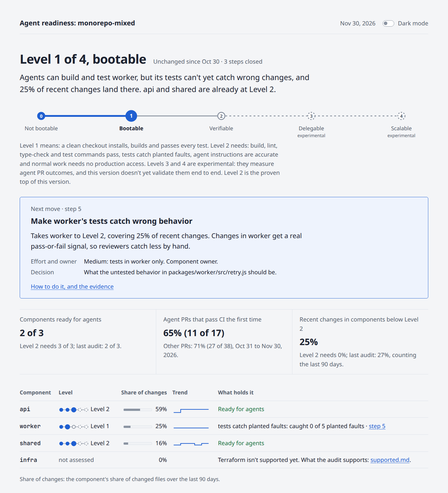
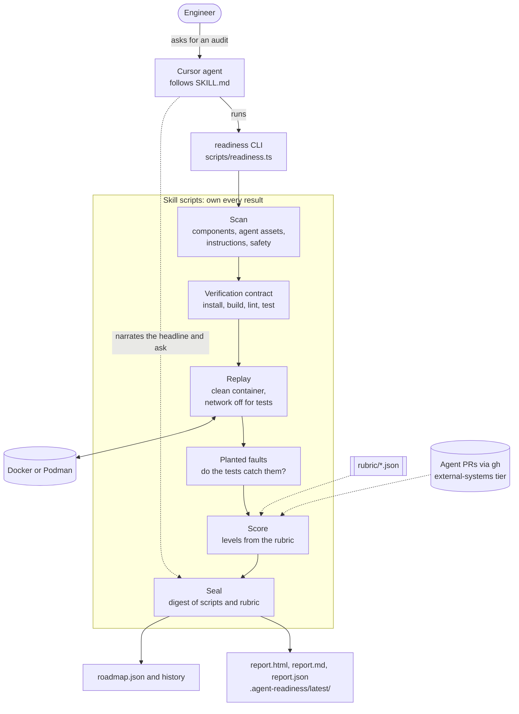

# Agent Readiness

A Cursor skill that finds what would stop a coding agent in a repository, and helps fix the two things that matter most: a working environment and a way to verify changes.



> The top of [`examples/sample-report.html`](examples/sample-report.html), the HTML report for a three-package monorepo fixture. The same sealed data is also written as Markdown and JSON.

It answers one question: what level is this repo at, and each app or component in it, and what are the top three things holding them back? Each of the three comes with a fix that can be proved and the outcome it should deliver.

It is not a gate to pass before you start using agents. When it finds no blocker, the report says so and recommends starting to delegate.

## Components

The agent drives the CLI; the scripts produce every result and seal it.



## How it works

- **It scores only what it ran.** Scripts install, build and test the repo in a clean container, plant faults its tests should catch, and replay every command in AGENTS.md, rules, skills and the README. The presence of a file never passes a check.
- **The agent can't grade its own work.** The skill's scripts create the evidence, choose the planted faults, compute every level and seal the audit with a digest of the scripts and rubric. The agent picks the scope, explains the result and stops. The seed and where faults were planted stay outside the repository until the seal, and a hand edit to the draft audit is refused at the next step. In CI, `SA_READINESS_SEAL_KEY` keys the seal, and wherever the key is set `verify-seal` accepts only keyed seals, so a seal from anywhere else doesn't verify there. The key never reaches the repo's code. These raise the bar; they don't make an audit on a machine the agent controls tamper-proof, so treat a keyed seal from CI as the production result.
- **Levels follow the work, in three tiers.** The repo gets one rollup level. Each app or component the scan finds gets one standard level, and part 5 of the report lists every component included or left out, with the reason. Scenarios, such as bug fixes or repo-wide changes, are optional breakdowns nested under the components they cover, present only when someone adds them. A monorepo can be at Level 2 in one package and not bootable in another.
- **The rollup rule is explicit.** The repo level is the lowest standard level among active components: the assessed ones with at least 10% of changes over 90 days, where a component joins or leaves that set only after two audits on the same side of the line. Components the audit can't assess never set it, and scenarios never change it. With no real check result there is no level at any tier. See [references/levels.md](skill/agent-readiness/references/levels.md).
- **It keeps score over time.** A roadmap with stable item IDs, a weekly recheck, and agent PR outcomes against other PRs show whether fixes paid off.

| Level | Name | Measured by |
|---|---|---|
| 0 | Not bootable | audit |
| 1 | Bootable: a clean checkout installs, builds and passes every test | audit |
| 2 | Verifiable: the commands pass, the tests catch planted faults, the instructions are accurate and normal work needs no production access | audit |
| 3 | Delegable: agent PRs meet the outcome targets your team set | outcomes |
| 4 | Scalable: those targets held while agent PR volume at least doubled | outcomes |

An audit never claims Level 3 or 4 by itself. Those need team-set targets over at least 20 agent PRs, compared with other PRs in the same window.

## Requirements

- **Node.js 22.14 or later** (type stripping; no packages for the skill itself).
- **Docker or Podman** to prove Level 1 in a clean container. Without a container runtime, the audit still runs in a scrubbed throwaway copy on the host and says Level 1 is not provable on this machine.
- Offline and air-gapped hosts can still run an audit when the base image and any private-registry credentials are already available locally. Pass `--image <ref>` for an approved internal image, and `--registry-env` for named install credentials (names are recorded; values never are). Without network after install, tests run with networking off. Sample reports under [examples/](examples/) open offline (HTML is self-contained: inline CSS and SVG, no scripts, nothing fetched).

## Quickstart

Copy the skill into the repository you want to audit:

```bash
cp -R software-factory/agent-readiness/skill/agent-readiness <repo>/.cursor/skills/agent-readiness
```

Then ask the agent in that repo: "Run an agent readiness audit." To see one kind of work broken out, ask for it, for example "and break out bug fixes for web".

To run it without an agent, from the repo root:

```bash
node --experimental-strip-types --no-warnings .cursor/skills/agent-readiness/scripts/readiness.ts audit --tier local-exec
```

## Reading the report

`.agent-readiness/latest/` holds the report three ways, all from the same sealed data: `report.json`, `report.md`, and `report.html`, a self-contained page that opens offline and in light mode, with a dark-mode switch in its header, and prints in light. Both views run in the same order, five parts and a closing note:

1. **Where am I now.** Only what the reader acts on: a notice when something needs doing, the level and what changed, the agent's one-message headline, the next move with what it unlocks, the level ladder (Levels 3 and 4 marked experimental), three numbers compared with the next level, and for a monorepo each component with its level, change share, trend and what holds it.
2. **Have I improved.** What changed since the last audit: level changes, conditions now met or now failing, checks that flipped, and the steps closed. A first audit says so.
3. **What moves the needle next.** The one ask, what the next level still needs, at most three gaps, and each step (numbered as in the roadmap) with what it unlocks, its effort, the evidence behind it and when it's done.
4. **Roadmap to the max level.** The steps for each level up to Level 4, and the ones that serve every level.
5. **Audit details.** The measures, coverage and history, exact steps, every check with why it matters and its evidence, levels by component with any scenarios nested under each, the repo level and its rule, agent PR outcomes, agent assets and their authors, and the evidence log.
6. **About this report.** Provenance, the seal status and eval-mode notes.

`report.json` (schema `agent-readiness/report@1`) is the view model. The markdown, the HTML page and any other renderer are views of it. See [references/report.md](skill/agent-readiness/references/report.md). Example sealed reports sit under [examples/](examples/).

## Records

- **On main:** `.agent-readiness/roadmap.json` (the ordered path, owner and Level 3 targets) and `.agent-readiness/latest/` (the latest report). One small commit per audit.
- **On the `agent-readiness/history` branch, or CI artifacts:** the sealed `audits/<id>/` folders and `history.jsonl`, one line per audit and recheck. `readiness history push --push` writes them; the scheduled recheck appends there only.

Redaction runs before every write, and a final secret scan blocks anything bound for history.

## Fixing what it finds

Say "fix the primary blocker". The skill then loads [remediate.md](skill/agent-readiness/remediate.md) and produces, each proved before it's offered:

- **An environment setup:** install and start scripts and a `.cursor/environment.json` that uses only `name`, `install` and `start`, proved by a new audit in a clean container. Committing the file doesn't configure Cloud Agents by itself; a team admin points the environment at it.
- **A verify skill:** `.cursor/skills/verify/SKILL.md`, written by `readiness draft-skill` from commands the audit ran and saw pass, with a failure playbook from failures the audits observed. It refuses commands the audit didn't run.

Tests added to catch planted faults are proved against a fresh set of faults the fixing session never saw.

## Enterprise repos

- **Private registries:** `--registry-env NPM_TOKEN,PIP_INDEX_URL` passes named variables to the install. Names are recorded and values never are. Without them, a 401 reads "registry credentials not provided", not a repo blocker.
- **Network:** tests run with networking off after the install.
- **Base images:** `--image <ref>` replays on an approved internal image. A repo-declared `.cursor/Dockerfile` in `environment.json` is built and used.
- **No container runtime:** the replay falls back to a fresh copy on the host, and part 1 says Level 1 can't be proved on that machine. A tool the host lacks, and every step behind it, is reported as blocked on this machine, never as a repo defect, and commands that use `sudo` are listed by the safety check and never run on the host. When nothing produced a real result, the report gives no level and says why.
- **Budgets:** `--budget-component` and `--budget-total` (15 and 60 minutes). The total covers the instruction replay too. Anything cut off counts as not run.
- **Write-mode lint:** lint and type-check run check-only, without `--write` or `--fix`, and lint runs before the build, so the audit doesn't rewrite the copy it plants faults in. See [supported.md](skill/agent-readiness/references/supported.md).

## Permission tiers

| Tier | Runs repo code | Reads GitHub |
|---|---|---|
| `read-only` | no | no |
| `local-exec` (default) | in a clean container or scrubbed copy | no |
| `external-systems` | yes | PR outcomes through `gh`, published release manifest |

Repo commands get an allowlisted environment: `PATH`, a temporary `HOME` and isolated package caches. `--inherit-env` passes the user's environment and should only be used with their approval.

## Develop and validate

```bash
npm ci
npm run check   # typecheck and unit tests; fixture audits need Docker or Podman
```

Maintainer evals, fixtures, baselines, goldens, labels, sample regeneration, release-gate tooling and example CI workflows live under [support/](support/). See [support/README.md](support/README.md).
